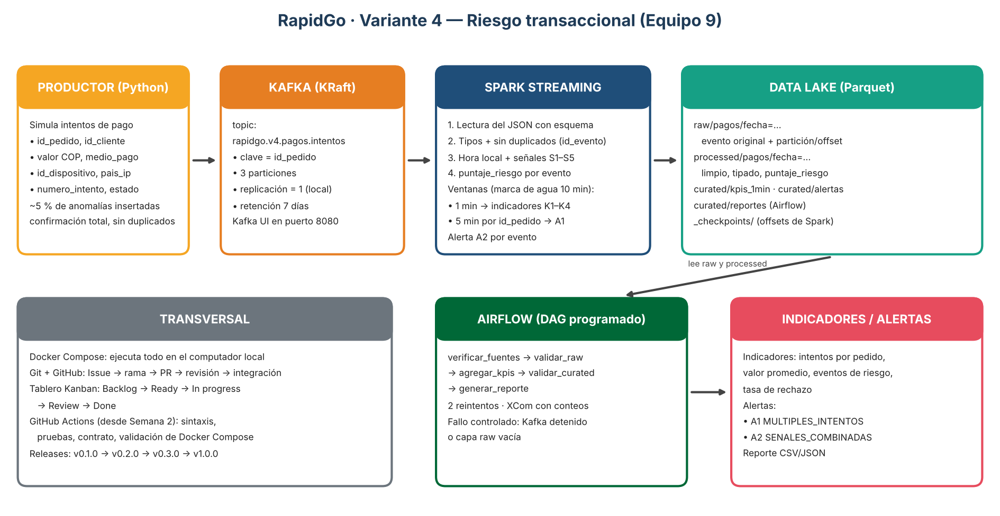

# RapidGo · Variante 4 — Riesgo transaccional

Flujo de datos Big Data de extremo a extremo para detectar **comportamientos atípicos durante los pagos y pedidos** de RapidGo.
Proyecto final — Línea de Profundización I (Big Data) · Ingeniería de Sistemas y Computación · Universidad de Cundinamarca, Facatativá.

| | |
|---|---|
| **Equipo** | 9 |
| **Integrantes** | Esteban Rueda · Oscar Becerra · Karol Perez |
| **Variante** | 4 — Riesgo transaccional |
| **Versión actual** | `v0.1.0-foundation` (Semana 1 · diseño y organización) |

## Problema de negocio
En una plataforma de domicilios, los pagos fallidos repetidos, los valores fuera de lo normal y las combinaciones
de señales sospechosas (IP extranjera, muchos reintentos, horario inusual) suelen indicar **prueba de tarjetas
robadas, fraude o fallas de la pasarela de pagos**. Detectarlo en minutos —y no al cierre del día— permite
bloquear pedidos, avisar al equipo antifraude y reducir las devoluciones de cargos.

**Valor de la solución:** indicadores en ventanas de 1 minuto y alertas automáticas por pedido y por evento,
con trazabilidad completa en un Data Lake por capas (raw → processed → curated).

## Arquitectura


| Componente | Función en la variante |
|---|---|
| Productor (Python) | Genera intentos de pago simulados con cerca de 5 % de anomalías insertadas |
| Kafka (modo KRaft) | Transporta los eventos en el topic `rapidgo.v4.pagos.intentos` (clave `id_pedido`, 3 particiones) |
| Spark Structured Streaming | Lee, limpia, calcula señales y puntaje de riesgo, indicadores por ventana y alertas |
| Data Lake (Parquet) | Capas raw → processed → curated (ver [datalake/README.md](datalake/README.md)) |
| Airflow | Valida la calidad, agrega, genera el reporte; reintentos y fallo controlado (Semana 3) |
| Docker, GitHub y GitHub Actions | Ejecución local, trazabilidad, integración continua y versiones |

## Contrato del evento
Evento `intento_pago` — esquema en [`samples/evento_pago.schema.json`](samples/evento_pago.schema.json);
ejemplos en [`samples/evento_pago.json`](samples/evento_pago.json) (normal) y
[`samples/evento_pago_anomalo.json`](samples/evento_pago_anomalo.json) (anómalo).

```json
{ "id_evento": "8f3c2a1e-5b7d-4c9a-9e21-3f6a0b7c1d42", "tipo_evento": "intento_pago", "version_esquema": "1.0",
  "equipo": "equipo9-v4", "fecha_evento": "2026-10-22T19:42:15.318Z", "id_pedido": "PED-20261022-004817",
  "id_cliente": "CLI-001523", "valor": 87500.0, "moneda": "COP", "medio_pago": "tarjeta_credito",
  "id_dispositivo": "DIS-7f21a9", "tipo_dispositivo": "android", "pais_ip": "CO", "ciudad": "Bogota",
  "latitud": 4.6533, "longitud": -74.0836, "numero_intento": 1, "estado": "aprobado", "motivo_rechazo": null }
```

## Kafka
| Topic | Clave | Particiones | Replicación | Retención |
|---|---|---|---|---|
| `rapidgo.v4.pagos.intentos` | `id_pedido` | 3 | 1 | 7 días |

Justificación en el [ADR-001](docs/decisions/ADR-001-topic-clave-particiones.md).

## Indicadores y alertas (umbrales iniciales)
Detalle completo en [docs/kpis_y_alertas.md](docs/kpis_y_alertas.md).

| Indicador | Definición |
|---|---|
| K1 Intentos por pedido | intentos / pedidos distintos por ventana de 1 minuto, y máximo de `numero_intento` |
| K2 Valor promedio | promedio de `valor`, total y por medio de pago |
| K3 Eventos de riesgo | cantidad y porcentaje de eventos con `puntaje_riesgo >= 60` |
| K4 Tasa de rechazo | porcentaje de intentos `rechazado` |

| Alerta | Regla |
|---|---|
| A1 `MULTIPLES_INTENTOS` | mismo `id_pedido` con 3 o más intentos, o 2 o más rechazos, en 5 minutos |
| A2 `SENALES_COMBINADAS` | `puntaje_riesgo >= 60` con al menos 2 señales (valor ≥ 500.000, IP fuera de Colombia, intento ≥ 3, rechazo sospechoso, entre las 00 y las 05 h) |

## Ejecución local (estado de la Semana 1)
Requisitos: Docker Desktop (con al menos 6 GB de memoria asignados), Git y Python 3.12 o superior.

```bash
git clone https://github.com/kiritosb12/rapidgo-v4-riesgo-transaccional.git
cd rapidgo-v4-riesgo-transaccional
docker compose up -d                 # Kafka + creación del topic + Kafka UI
docker compose logs kafka-init       # debe mostrar PartitionCount: 3
# Kafka UI: http://localhost:8080
pip install -r requirements.txt
pytest -v                            # valida el contrato del evento
docker compose down
```

## Plan de versiones
| Versión | Semana | Contenido |
|---|---|---|
| `v0.1.0-foundation` | 1 | Arquitectura, contrato, indicadores y alertas, Kanban, ADR-001 |
| `v0.2.0-streaming` | 2 | Productor + Kafka + Spark + Data Lake + integración continua |
| `v0.3.0-orchestration` | 3 | DAG de Airflow, calidad, fallo controlado, integración continua ampliada |
| `v1.0.0` | 4 | Control de calidad final, README final, video |

## Documentación
- Puntos de control semanales: [`docs/checkpoints/`](docs/checkpoints/)
- Registros de decisiones de arquitectura (ADR): [`docs/decisions/`](docs/decisions/)

## Contribuciones
| Integrante | Responsabilidades en la Semana 1 | Issues |
|---|---|---|
| Esteban Rueda | Indicadores, reglas de alerta, topic/clave/particiones, ADR-001 | #3, #4 |
| Oscar Becerra | Estructura del repositorio, arquitectura, README, versión | #1, #5, #7 |
| Karol Perez | Contrato JSON + esquema + prueba, docker-compose preliminar | #2, #6 |

_Se actualizará cada semana. Enlace al video final: pendiente (Semana 4)._
