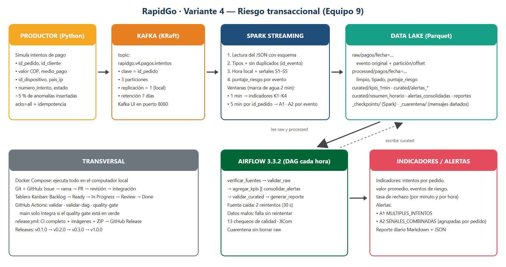

# RapidGo · Variante 4 — Riesgo transaccional

[](https://github.com/kiritosb12/rapidgo-v4-riesgo-transaccional/actions/workflows/ci.yml)

Flujo de datos Big Data de extremo a extremo para detectar **comportamientos atípicos durante los pagos y pedidos** de RapidGo.
Proyecto final — Línea de Profundización I (Big Data) · Ingeniería de Sistemas y Computación · Universidad de Cundinamarca, Facatativá.

| | |
|---|---|
| **Equipo** | 9 |
| **Integrantes** | Esteban Rueda ([@jers120506-gif](https://github.com/jers120506-gif)) · Oscar Becerra ([@kiritosb12](https://github.com/kiritosb12)) · Karol Perez ([@Karitoperez](https://github.com/Karitoperez)) |
| **Variante** | 4 — Riesgo transaccional |
| **Versión actual** | `v1.0.0` (versión final · integración, quality gate y video) — [notas](docs/release-notes/v1.0.0.md) |
| **Tablero Kanban** | [RapidGo V4 – Kanban](https://github.com/users/kiritosb12/projects/2) (20 Issues, Semanas 1 a 4) |

## Problema de negocio
En una plataforma de domicilios, los pagos fallidos repetidos, los valores fuera de lo normal y las combinaciones
de señales sospechosas (IP extranjera, muchos reintentos, horario inusual) suelen indicar **prueba de tarjetas
robadas, fraude o fallas de la pasarela de pagos**. Detectarlo en minutos —y no al cierre del día— permite
bloquear pedidos, avisar al equipo antifraude y reducir las devoluciones de cargos.

**Valor de la solución:** indicadores en ventanas de 1 minuto y alertas automáticas por pedido y por evento,
con trazabilidad completa en un Data Lake por capas (raw → processed → curated).

## Arquitectura


| Componente | Función en la variante |
|---|---|
| Productor (Python) | Genera intentos de pago simulados con cerca de 5 % de anomalías insertadas |
| Kafka (modo KRaft) | Transporta los eventos en el topic `rapidgo.v4.pagos.intentos` (clave `id_pedido`, 3 particiones) |
| Spark Structured Streaming | Lee, limpia, calcula señales y puntaje de riesgo, indicadores por ventana y alertas |
| Data Lake (Parquet) | Capas raw → processed → curated (ver [datalake/README.md](datalake/README.md)) |
| Airflow | Valida la calidad de raw y curated, resume por hora, agrupa las alertas por pedido y genera el reporte; reintentos y cuarentena |
| Docker, GitHub y GitHub Actions | Ejecución local, trazabilidad, integración continua, quality gate y versiones |

## Tecnologías utilizadas
| Tecnología | Versión | Rol en la solución |
|---|---|---|
| Python | 3.12 (Docker) / 3.13 (CI) | Productor, tareas de Airflow, pruebas |
| confluent-kafka | 2.16.0 | Cliente del productor: clave `id_pedido`, `acks=all`, idempotencia |
| Apache Kafka (KRaft) + Kafka UI | 3.8.0 | Transporte de eventos; topic con 3 particiones |
| PySpark (Structured Streaming) | 4.1.3 | Limpieza, señales de riesgo, indicadores por ventana y alertas |
| Parquet + pyarrow/pandas | — | Formato del Data Lake; lectura desde Airflow |
| Apache Airflow + PostgreSQL | 3.3.2 / 16 | Orquestación: DAG de calidad, alertas consolidadas y reporte |
| Docker Compose | — | Ejecución local de todos los servicios |
| pytest | 8 | Pruebas de contrato, reglas, productor, Spark, orquestación y DAG |
| GitHub (Projects, Issues, PR, Actions, Releases) | — | Trazabilidad, CI, quality gate y versiones |

## Contrato del evento
Evento `intento_pago` — esquema en [`samples/evento_pago.schema.json`](samples/evento_pago.schema.json);
ejemplos en [`samples/evento_pago.json`](samples/evento_pago.json) (normal) y
[`samples/evento_pago_anomalo.json`](samples/evento_pago_anomalo.json) (anómalo).

```json
{ "id_evento": "8f3c2a1e-5b7d-4c9a-9e21-3f6a0b7c1d42", "tipo_evento": "intento_pago", "version_esquema": "1.0",
  "equipo": "equipo9-v4", "fecha_evento": "2026-10-22T19:42:15.318Z", "id_pedido": "PED-20261022-004817",
  "id_cliente": "CLI-001523", "valor": 87500.0, "moneda": "COP", "medio_pago": "tarjeta_credito",
  "id_dispositivo": "DIS-7f21a9", "tipo_dispositivo": "android", "pais_ip": "CO", "ciudad": "Bogota",
  "latitud": 4.6533, "longitud": -74.0836, "numero_intento": 1, "estado": "aprobado", "motivo_rechazo": null }
```

## Kafka
| Topic | Clave | Particiones | Replicación | Retención |
|---|---|---|---|---|
| `rapidgo.v4.pagos.intentos` | `id_pedido` | 3 | 1 | 7 días |

Justificación en el [ADR-001](docs/decisions/ADR-001-topic-clave-particiones.md).

## Indicadores y alertas
Detalle completo en [docs/kpis_y_alertas.md](docs/kpis_y_alertas.md). Spark los calcula en ventanas de 1 minuto con
marca de agua de 2 minutos ([ADR-002](docs/decisions/ADR-002-marca-de-agua.md)); Airflow los resume por hora y agrupa las alertas por pedido.

| Indicador | Definición |
|---|---|
| K1 Intentos por pedido | intentos / pedidos distintos por ventana de 1 minuto, y máximo de `numero_intento` |
| K2 Valor promedio | promedio de `valor`, total y por medio de pago |
| K3 Eventos de riesgo | cantidad y porcentaje de eventos con `puntaje_riesgo >= 60` |
| K4 Tasa de rechazo | porcentaje de intentos `rechazado` |

| Alerta | Regla |
|---|---|
| A1 `MULTIPLES_INTENTOS` | mismo `id_pedido` con 3 o más intentos, o 2 o más rechazos, en 5 minutos |
| A2 `SENALES_COMBINADAS` | `puntaje_riesgo >= 60` con al menos 2 señales (valor ≥ 500.000, IP fuera de Colombia, intento ≥ 3, rechazo sospechoso, entre las 00 y las 05 h) |

## Ejecución local
Requisitos: Docker Desktop con **al menos 6 GB de memoria** asignados (8 GB recomendados con Airflow), Git y, para correr las pruebas en el
computador, Python 3.12+ y Java 17+ (opcional: sin Java las pruebas de Spark se omiten).

```bash
git clone https://github.com/kiritosb12/rapidgo-v4-riesgo-transaccional.git
cd rapidgo-v4-riesgo-transaccional
docker compose up -d --build          # Kafka + topic + Kafka UI + Spark + productor + PostgreSQL + Airflow
docker compose logs kafka-init        # debe mostrar PartitionCount: 3
docker compose logs -f spark          # lotes de cada consulta (la 1.ª vez descarga el conector de Kafka)
```

Prueba completa de punta a punta: levanta todo, espera datos en el lago, ejecuta el DAG y termina con error si algo
no queda en verde ([`scripts/prueba_e2e.sh`](scripts/prueba_e2e.sh); en Windows, desde Git Bash):

```bash
bash scripts/prueba_e2e.sh --limpio   # prueba completa desde cero (≈ 5 min)
bash scripts/prueba_e2e.sh            # usa lo que ya esté corriendo
```

| Servicio | Qué hace | Acceso |
|---|---|---|
| `kafka` / `kafka-init` | Broker KRaft y creación del topic con 3 particiones | `localhost:29092` |
| `kafka-ui` | Ver mensajes, particiones y offsets | http://localhost:8080 |
| `spark` | 5 consultas continuas → `datalake/` | http://localhost:4040 (pestaña *Structured Streaming*) |
| `productor` | ~10 eventos/s; termina si se define `DURACION_PRODUCTOR` | `docker compose logs productor` |
| `postgres` + `airflow-init` | Base de datos de Airflow (se prepara sola) | — |
| `airflow-apiserver` / `airflow-scheduler` / `airflow-dag-processor` | Interfaz, ejecución de tareas y lectura de DAG | http://localhost:8081 |

Parámetros (variables de entorno al levantar): `EVENTOS_POR_SEGUNDO` (10), `DURACION_PRODUCTOR` (0 = sin
límite), `INTERVALO_LOTE` (`10 seconds`), `RETRASO_MAXIMO` (marca de agua, ver ADR-002). Ejemplo:

```bash
EVENTOS_POR_SEGUNDO=20 DURACION_PRODUCTOR=900 docker compose up -d --build   # 15 minutos a 20 eventos/s
```

Ver los resultados y medir la ejecución:

```bash
docker compose run --rm --no-deps spark python scripts/metricas_semana2.py   # tablas Markdown con valores reales
docker compose stop productor spark                                 # detener (el checkpoint guarda el avance)
docker compose down                                                 # apagar todo
```

## Airflow: control de calidad y reporte
`docker compose up -d --build` también levanta PostgreSQL y Airflow 3.3.2 (api-server, scheduler y dag-processor).
La primera vez tarda unos minutos en construir la imagen.

| Qué | Dónde |
|---|---|
| Interfaz de Airflow (sin usuario ni contraseña, solo uso local) | http://localhost:8081 |
| DAG | `rapidgo_riesgo_transaccional` ([airflow/dags/](airflow/dags/rapidgo_riesgo_transaccional.py)) — cada hora, pausado al crearse |
| Lógica de las tareas (Python puro, probada con pytest) | [orquestacion/tareas.py](orquestacion/tareas.py) |
| Reportes | `datalake/curated/reportes/fecha=AAAA-MM-DD/` |

```
verificar_fuentes → validar_raw → ┬→ agregar_kpis ───────┬→ validar_curated → generar_reporte
                                  └→ consolidar_alertas ─┘
```

| Tarea | Qué hace | Si falla |
|---|---|---|
| `verificar_fuentes` | Kafka responde; raw y processed tienen archivos de la fecha; si es hoy, raw recibió datos en los últimos 10 min (`MAX_MINUTOS_SIN_DATOS`) | se reintenta 2 veces (30 s) |
| `validar_raw` | offsets sin huecos ni repetidos por partición, ≤ 1 % de mensajes inválidos, desbalance entre particiones | falla sin reintentar |
| `agregar_kpis` | indicadores por hora → `curated/resumen_horario/` | falla sin reintentar |
| `consolidar_alertas` | A1 + A2 agrupadas por pedido → `curated/alertas_consolidadas/` | falla sin reintentar |
| `validar_curated` | rangos de K1–K4, ventanas continuas, intentos de `kpis_1min` = processed, alertas con pedido real | falla sin reintentar |
| `generar_reporte` | reúne los XCom de las 5 tareas y escribe el reporte Markdown + JSON | — |

Ejecutar: en la interfaz, activar el DAG (interruptor) y pulsar **Trigger**; el parámetro `fecha` (AAAA-MM-DD,
hora de Bogotá) es opcional (vacío = hoy). Por consola:

```bash
docker compose exec airflow-scheduler airflow dags unpause rapidgo_riesgo_transaccional
docker compose exec airflow-scheduler airflow dags trigger rapidgo_riesgo_transaccional
```

**Mensajes dañados en raw.** raw no se borra; si `validar_raw` falla por mensajes inválidos y ya se revisó su
origen, se ponen en cuarentena y se hace Clear de `validar_raw`:

```bash
docker compose exec airflow-scheduler python -m orquestacion.cuarentena --fecha AAAA-MM-DD --solo-mostrar
docker compose exec airflow-scheduler python -m orquestacion.cuarentena --fecha AAAA-MM-DD --motivo "explicación"
```

Por qué unas fallas se reintentan y otras no, y los 3 fallos controlados (uno por integrante) con su recuperación:
[ADR-003](docs/decisions/ADR-003-orquestacion-y-recuperacion.md) y [punto de control de la Semana 3](docs/checkpoints/semana3.md).

## Pruebas e integración continua
```bash
pip install -r requirements.txt
pytest -v                                                   # contrato, reglas, productor y Spark
python -m producer.productor_pagos --modo-seco --max-eventos 5   # productor sin Kafka
```

El flujo [`.github/workflows/ci.yml`](.github/workflows/ci.yml) se ejecuta en cada push a `main`, en cada
Pull Request y a mano (*Actions → CI RapidGo → Run workflow*) con tres trabajos:

- **`validar`**: sintaxis, `pytest` (contrato, reglas, productor, Spark y tareas de orquestación), productor en
  modo seco y `docker compose config`.
- **`validar-dag`**: instala Airflow 3.3.2 con sus restricciones oficiales, importa el DAG y comprueba sus
  6 tareas, dependencias y reintentos (`tests/test_dag.py`).

- **`quality-gate`**: solo pasa si `validar` y `validar-dag` pasaron. `main` lo exige para integrar.

Sin Airflow instalado, `tests/test_dag.py` aparece como *skipped* en el computador; en el CI corren todas.

**Versiones:** al subir una etiqueta `vX.Y.Z`, [`release.yml`](.github/workflows/release.yml) vuelve a
correr todo el CI, construye las imágenes de Docker, empaqueta el código y publica el GitHub Release con
las notas de `docs/release-notes/`. Si algo falla, no se libera.

## Resultados
Ejecución final desde cero (`scripts/prueba_e2e.sh --limpio`, ⟨fecha⟩, ⟨N⟩ min a 10 eventos/s):

| Medida | Valor |
|---|---|
| Mensajes y reparto por partición | ⟨N⟩ · ⟨__ / __ / __ %⟩ · 0 huecos de offsets |
| Duplicados eliminados por Spark | ⟨N⟩ (⟨__ %⟩) |
| Retraso evento → processed (p95) | ⟨__ s⟩ |
| Eventos de riesgo (K3) | ⟨N⟩ (⟨__ %⟩) |
| Alertas A1 / A2 por intento / pedidos con A2 | ⟨N⟩ / ⟨N⟩ / ⟨N⟩ (−⟨__ %⟩ al agrupar) |
| DAG en verde | ⟨__ s⟩, 13 chequeos de calidad |
| Fallos controlados recuperados | 3 (Kafka, Spark, mensajes dañados) — ver [ADR-003](docs/decisions/ADR-003-orquestacion-y-recuperacion.md) |

Evidencias: [reporte final](docs/evidencias/semana4_reporte_final.md) · [prueba de punta a punta](docs/evidencias/semana4_prueba_e2e.txt) ·
[métricas](docs/evidencias/semana4_metricas_final.md) · puntos de control de las semanas [1](docs/checkpoints/semana1.md),
[2](docs/checkpoints/semana2.md) y [3](docs/checkpoints/semana3.md).

## Limitaciones conocidas y trabajo futuro
| Limitación | Trabajo futuro |
|---|---|
| Datos simulados por el productor (5 % de anomalías fijado por nosotros) | Probar con datos reales o anonimizados |
| Un solo broker de Kafka (factor de replicación 1): si cae, el flujo se detiene | 3 brokers con replicación 3 |
| Spark en modo local dentro de un contenedor | Clúster (Spark standalone o Kubernetes) |
| A1 usa ventanas fijas de 5 min: una ráfaga que cruza el borde se parte en dos | Ventanas deslizantes o agrupación por sesión |
| Reglas con umbrales fijos, no aprenden | Modelo de detección de anomalías entrenado con el histórico |
| Muchos archivos Parquet pequeños (un lote cada 10 s) | Tarea de compactación en el DAG |
| Las alertas quedan en el lago; nadie recibe un aviso | Notificación por correo o Slack desde Airflow |
| Airflow sin usuarios (solo uso local) y revisión cada hora | Usuarios y roles; revisión más frecuente |
| La cuarentena se registra a mano | Detección automática con aprobación del equipo |

## Plan de versiones
| Versión | Semana | Contenido |
|---|---|---|
| `v0.1.0-foundation` | 1 | Arquitectura, contrato, indicadores y alertas, Kanban, ADR-001 |
| `v0.2.0-streaming` | 2 | Productor + Kafka + Spark + Data Lake + integración continua |
| `v0.3.0-orchestration` | 3 | DAG de Airflow, calidad, fallo controlado, integración continua ampliada |
| `v1.0.0` | 4 | Prueba de punta a punta, quality gate, release automático, README final y video |

Todas las versiones: [Releases](https://github.com/kiritosb12/rapidgo-v4-riesgo-transaccional/releases).

## Documentación
- Indicadores y alertas: [`docs/kpis_y_alertas.md`](docs/kpis_y_alertas.md)
- Data Lake: [`datalake/README.md`](datalake/README.md)
- Registros de decisiones de arquitectura: [ADR-001](docs/decisions/ADR-001-topic-clave-particiones.md) · [ADR-002](docs/decisions/ADR-002-marca-de-agua.md) · [ADR-003](docs/decisions/ADR-003-orquestacion-y-recuperacion.md)
- Notas de la versión final: [`docs/release-notes/v1.0.0.md`](docs/release-notes/v1.0.0.md)
- Puntos de control semanales: [Semana 1](docs/checkpoints/semana1.md) · [Semana 2](docs/checkpoints/semana2.md) · [Semana 3](docs/checkpoints/semana3.md)

## Contribuciones
| Integrante | Responsabilidades | Issues | PR principales | Revisiones |
|---|---|---|---|---|
| Esteban Rueda | Indicadores y umbrales, contrato JSON y ADR-001; productor; `ci.yml`; lectura del lago, `validar_raw`, DAG y reporte; fallo 1; prueba de punta a punta; video | #2 #3 #4 #8 #11 #13 #16 #17 #20 | #23 #24 #26 #30 #31 #38 #40 #42 ⟨#N e2e⟩ ⟨#N video⟩ | #22 #25 #27 #36 #37 #39 #41 #45 #46 |
| Oscar Becerra | Estructura, docker-compose inicial, arquitectura y README; Spark y Data Lake; ADR-002; indicadores por hora, alertas consolidadas y `validar_curated`; fallo 2; ADR-003; quality gate y release | #1 #2 #5 #6 #7 #9 #12 #13 #16 #18 | #22 #25 #27 #28 #29 #32 #35 #36 #39 #43 #45 #46 | #23 #24 #26 #30 #31 #33 #34 #38 #40 #42 #44 ⟨#N README⟩ ⟨#N video⟩ |
| Karol Perez | Indicadores K1–K4 y alertas en Spark; pruebas de reglas y script de métricas; Airflow y PostgreSQL en Compose; CI con el DAG; fallo 3 y cuarentena; README final | #10 #11 #14 #15 #16 #19 | #33 #34 #37 #41 #44 ⟨#N README⟩ | #32 #35 #38 #43 ⟨#N e2e⟩ ⟨#N video⟩ |

Detalle por semana:

### Contribuciones (Semana 1)
| Integrante | Trabajo realizado | Pull Requests propios | Revisiones aprobadas |
|---|---|---|---|
| Esteban Rueda | Indicadores y reglas de alerta (#3), topic, clave, particiones y ADR-001 (#4), contrato JSON y ejemplos (#2) | #23, #24, #26 | #22, #25, #27 |
| Oscar Becerra | Estructura del repositorio (#1), docker-compose preliminar (#6), arquitectura y README (#5), corrección del esquema y prueba del contrato (#2), punto de control y versión (#7) | #22, #25, #27, #28, #29 | #23, #24, #26 |
| Karol Perez | — | — | — |

### Contribuciones (Semana 2)
| Integrante | Trabajo realizado | Pull Requests propios | Revisiones aprobadas |
|---|---|---|---|
| Esteban Rueda | Integración continua `ci.yml`, dependencias y configuración de pytest (#11), productor de intentos de pago (#8) | #30, #31 | #36 |
| Oscar Becerra | Spark Structured Streaming raw/processed, Dockerfile y servicios de Docker Compose (#9), protección de `main` con el CI, ADR-002, punto de control y versión (#12) | #32, #35, #36 | #30, #31, #33, #34 |
| Karol Perez | Indicadores K1–K4 y alertas A1/A2 en Spark (#10), pruebas de reglas y script de métricas (#11) | #33, #34 | #32, #35 |

### Contribuciones (Semana 3)
| Integrante | Trabajo realizado | Pull Requests propios | Revisiones aprobadas |
|---|---|---|---|
| Esteban Rueda | Lectura del Data Lake, `verificar_fuentes` y `validar_raw` (#13); DAG con reintentos y XCom y reporte (#13); fallo controlado 1 | #38, #40, #42 | #37, #39, #41 |
| Oscar Becerra | Indicadores por hora, alertas consolidadas por pedido y `validar_curated` (#13); fallo controlado 2; ADR-003, punto de control y versión (#16) | #39, #43, #45 | #38, #40, #42, #44 |
| Karol Perez | Airflow y PostgreSQL en Docker Compose (#15); CI con importación del DAG (#14); fallo controlado 3 y cuarentena | #37, #41, #44 | #38, #43 |
